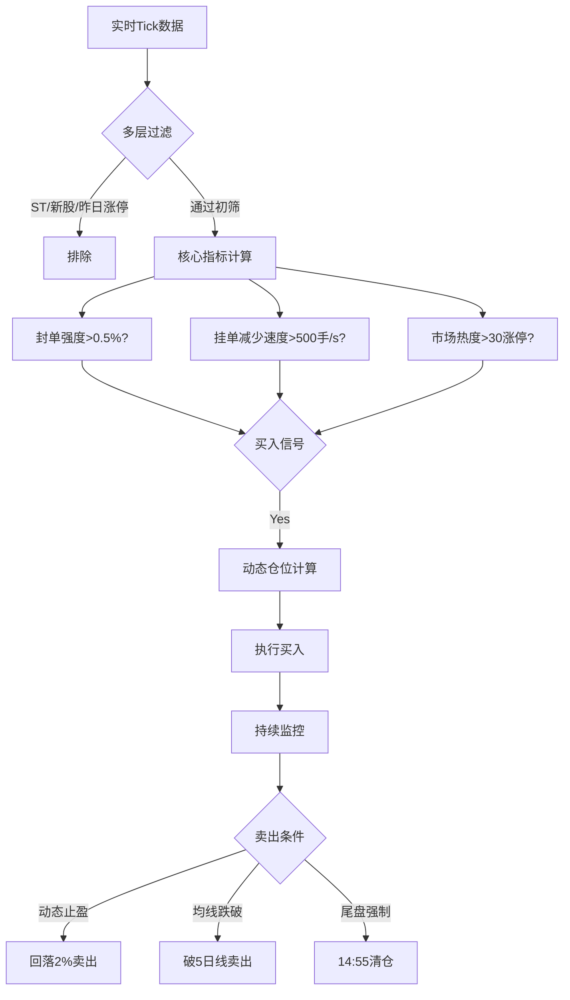

# curs

Curs 是一个个人自动化量化投资平台。

[English Version](README_EN.md) | 中文版

## 当前运行模式：仅记录信号

[热点股研究台](http://localhost:5000/finance-board) 支持点击股票并按日期查看报告和引用来源。可手动分析个股或全榜，Curs 每天北京时间 21:30 通过 WorkBuddy Desktop Bridge 逐只分析最新热点榜，最多 100 只，并补跑未完成的报告。详见[研究台使用指南](docs/STOCK_INTELLIGENCE.md)。

热点榜采集直接抓取 WhatsHot 公开网页上的同花顺热股榜，不用 API Key、不直连同花顺上游；采集需要 Chrome 渲染页面。Curs Web 服务会在工作日北京时间 15:35 后自动同步，也可在股票池页面手动触发；列表显示来源和采集时间。GitHub Actions 的每日抓取已停用。详情见 [WhatsHot 热股榜接入说明](docs/WHATSHOT_INTEGRATION.md)。

连板接力第一版在已有市场情绪页增加一进二、二进三、高位接力影子观察，记录环境、封板采样及题材依据，不修改原策略或触发交易。默认题材分组为空，不会默认通过。见 [设计与后续规划](docs/RELAY_V1.md)。

信号列表、图表和前向观察默认按“上海交易日 + 股票 + 买卖方向”合并独立机会，展开保留各策略原始触发。综合价格观察取最早触发及其自身记录，不累加数量；策略对比仍使用各自参考价。原始 API 默认不变，列表使用 `view=opportunities`。

新增观察页面采用高对比亮色样式、16px 正文字号与可横向滚动的表格；候选状态和确认依据使用中文说明，长时间戳简化显示但保留秒。

2026-10-14 进行了时间、状态、持久化与旧页面兼容审查，修复时区显示、首个事件遗漏、确认状态覆盖、镜像锁阻塞、热点导入事务和旧收益页 QMT 依赖。审查范围、测试及限制见 [审查记录](docs/REVIEW_20261014.md)。

股票接口统一补充名称和显示标签，信号、候选观察与持仓展示代码及名称；历史名称优先从本地证券资料、全市场名单和行情缓存解析，不在页面请求中调用外部行情。新信号本地日志同时保存名称。

工作日 16:00 盘后任务将完整涨停快照保存到原有 PostgreSQL `zt_stocks` 表（新增可空 `snapshot JSONB` 字段），次日情绪分析优先读取数据库。旧代码记录仍可展示价格表现，但缺失连板高度不猜测补齐。

代码兼容修复同时包含 `302` 创业板前缀；真实接口完整名单解析验证通过。

全市场名单兼容 `689` 前缀科创板证券（如九号公司-WD）；未知证券代码报错会显示代码与市场，便于定位数据兼容问题。

新增 [全市场情绪观察](http://localhost:5000/market-sentiment)：独立采集沪深京名单与行情，展示分市场覆盖、广度、昨日涨停固定样本和盘中晋级梯队。覆盖不足不判断情绪，规则状态仅为观察，不预测明日资金。配置在 `market_sentiment`；详见 [设计文档](docs/SIGNAL_ONLY.md)。

新增独立 `first_board_confirmation` 首板快照确认策略，与旧策略并行记录。观察页面显示候选、确认、放弃原因；连续封板、成交额增加和同步走强满足后才生成观察信号，不代表可成交或盈利。配置在 `market_data.first_board`。

新增 [信号前向观察页面](http://localhost:5000/signal-review)：显示行情新鲜度与覆盖率、热点池每分钟环境快照和信号后续价格记录。新鲜覆盖率不足默认 80% 时暂停策略行情事件；不确认成交、不计算实际交易收益。详见 [设计文档](docs/SIGNAL_ONLY.md)。

本项目现使用腾讯公开五档行情（默认每 5 秒轮询），保留原涨停板策略，不启动 QMT、不下单、不启动新版 Trading Agent。公开快照不是逐笔 Tick，短暂的盘口变化可能无法捕获；没有满足条件时不会生成信号。

配置使用 `signal_only: true`、`broker: signal`。信号先持久化到 `data/strategy_records/signals.sqlite3`，再同步 PostgreSQL，状态为 `SIGNAL_ONLY`，可在 `/signals` 查看。数据库暂时不可用时保留本地记录并重试。

Windows 使用 `scripts/start_curs.ps1` 启动本项目（端口 5000），`scripts/setup_schedule.ps1` 更新已有启动任务；盘后采集公开涨停股列表。详细配置、任务和限制见 [仅信号模式设计](docs/SIGNAL_ONLY.md)。下方实盘账户、QMT 和交易流程属于历史能力，不适用于当前默认运行模式。

## 功能特性

- **公开行情** - 使用腾讯五档快照，默认每 5 秒轮询
- **多交易商** - 交易账户支持 QMT 或东方财富证券
- **策略交易** - 支持多策略同时运行，策略热加载
- **信号管理** - 策略信号持久化和去重，当前不执行交易
- **持仓管理** - 实时持仓监控，一键清仓
- **股票池** - 自定义股票池，分类管理
- **定时任务** - 可配置定时执行数据同步、盈利分析等任务
- **Web 界面** - 图形化监控和管理

## 策略逻辑



## 环境要求

- Python 3.10+ (推荐)
- PostgreSQL 12+
- 能访问公开行情接口；当前模式不需要 QMT 或实盘账户

## 安装

```bash
# 克隆项目
git clone <repository-url>
cd curs

# 创建虚拟环境（可选）
python -m venv venv
venv\Scripts\activate  # Windows
# source venv/bin/activate  # Linux/Mac

# 安装依赖
pip install -r requirements.txt

# 安装项目
python setup.py install
```

## 配置

配置文件 `config.yml`（敏感配置请使用 `config.local.yml`）：

```yaml
version: 0.1.0

# 数据库配置
database:
  host: 192.168.2.238
  port: 6432
  database: postgres
  user: postgres
  password: ""  # 建议使用 config.local.yml

# 交易商，可选 qmt 或 eastmoney
broker: qmt

# QMT 配置（broker: qmt 时使用）
qmt:
  path: ""
  account_id: ""  # 建议使用 config.local.yml
  trader_name: ""

# 东方财富配置（broker: eastmoney 时使用）
eastmoney:
  account_no: ""
  password: ""  # 必须放在 config.local.yml 或环境变量中
  session_file: data/eastmoney_trader.session

# 策略配置
strategy:
  path: ./strategies
```

### 本地配置

敏感信息请放在 `config.local.yml`（已被 gitignore 忽略）：

```yaml
database:
  password: your_password

qmt:
  path: E:\qmt\userdata_mini
  account_id: "YOUR_ACCOUNT_ID"
  trader_name: curs
```

使用东方财富时，本地配置改为：

```yaml
broker: eastmoney

eastmoney:
  account_no: "YOUR_FUND_ACCOUNT"
  password: "YOUR_TRADING_PASSWORD"
  session_file: data/eastmoney_trader.session
```

或使用环境变量：

```bash
set CURS_DB_PASSWORD=your_password
set CURS_QMT_ACCOUNT_ID=YOUR_ACCOUNT_ID
```

东方财富也可完全通过环境变量配置：

```bat
set CURS_BROKER=eastmoney
set CURS_EASTMONEY_ACCOUNT_NO=YOUR_FUND_ACCOUNT
set CURS_EASTMONEY_PASSWORD=YOUR_TRADING_PASSWORD
set CURS_EASTMONEY_SESSION_FILE=data/eastmoney_trader.session
```

## 东方财富证券接入

东方财富接入使用资金账号和交易密码登录网页交易网关，不通过 QMT 下单。首次登录会自动识别图片验证码，并将登录会话缓存到 `session_file`；缓存失效后会自动重新登录。由于当前行情引擎仍基于 `xtquant`，运行实时策略前仍需启动 MiniQMT 行情服务。

1. 确认东方财富证券网页交易可正常登录，账户未被锁定，交易权限正常。
2. 执行 `pip install -r requirements.txt`，安装 `pycryptodome`、`ddddocr` 和 `pillow`。
3. 在已被 Git 忽略的 `config.local.yml` 中设置 `broker: eastmoney`、资金账号和交易密码。
4. 启动 MiniQMT 行情服务；东方财富仅替换交易账户，不替换现有行情源。
5. 首次建议执行 `python run.py --engine-only -v`，观察日志中是否出现“东方财富账户登录成功”。
6. 启动完整服务后访问持仓管理页面，核对资金和持仓。先在 Web 策略管理中关闭实盘，仅验证信号；确认无误后再开启实盘。

策略通过统一工厂创建账户，无需写死交易商：

```python
from curs.broker import create_account

context.account = create_account(config, total_cash=100000)
```

目前东方财富适配支持资金与持仓查询、限价/市价参数买卖、撤单、当日委托与成交、一键清仓。A 股仍遵循 T+1；清仓只卖出接口返回的可用数量。行情引擎当前仍使用 QMT/xtquant 数据链路，因此选择东方财富只替换交易账户，不会替换行情源。

> 风险提示：该接入依赖东方财富网页交易接口，接口或登录校验变化可能导致不可用。`config.local.yml` 和 `*.session` 都包含敏感信息，不应提交、分享或放入同步盘。请先小额、信号模式验证，实盘交易风险由使用者自行承担。

## 项目结构

```
curs/
├── curs/
│   ├── api/              # API 接口
│   ├── broker/           # 交易接口 (QMT / 东方财富)
│   ├── collection/       # 数据采集
│   │   └── eastmoney_hot_stocks.py  # 东财热点股票
│   ├── core/             # 核心引擎
│   ├── data_source/      # 历史数据
│   ├── database.py       # 数据库管理
│   ├── log_handler/      # 日志模块
│   ├── strategy/         # 策略加载执行
│   └── utils/            # 工具函数
│       ├── config.py          # 配置加载（支持本地覆盖）
│       ├── task_scheduler.py  # 定时任务调度器
│       └── task_callbacks.py  # 动态任务执行器
├── web/
│   ├── app.py            # Web 服务
│   └── templates/        # 前端页面
├── strategies/           # 策略文件目录
├── data/                 # 数据目录
│   └── create_scheduled_tasks.sql  # 定时任务表SQL
├── test/                 # 测试文件
│   ├── test_config.py           # 配置模块测试
│   ├── test_task_scheduler.py   # 任务调度测试
│   └── test_task_callbacks.py   # 任务执行测试
├── .github/
│   └── workflows/        # GitHub Actions CI
├── run.py                # 统一启动入口
└── config.yml            # 配置文件
```

## 数据库初始化

首次运行前需要创建数据库表：

```bash
# 创建数据库表
psql -h 192.168.2.238 -U postgres -d postgres -f data/create_scheduled_tasks.sql
```

或者通过 Web 界面自动创建（首次访问时会尝试创建）。

## 启动

```bash
# 使用统一入口启动（推荐）
python run.py                    # 启动所有服务（Web + 引擎）
python run.py --help             # 查看帮助

# 单独启动
python run.py --web-only         # 仅启动Web服务
python run.py --engine-only      # 仅启动交易引擎

# 指定端口
python run.py -p 8080            # Web端口8080
```

访问 http://localhost:5000 进入管理界面。

### 批处理脚本

`E:\script\` 目录下提供了 Windows 批处理脚本：

| 脚本 | 说明 |
|------|------|
| `start_all.bat` | 隐藏启动 Curs（公开行情 + 信号） |
| `startqmt.bat` | 已禁用，不启动 QMT |
| `startcurs.bat` | 单独启动 Curs |
| `start_web.bat` | 仅启动 Web 服务 |
| `restart_premarket.bat` | 仅重启原项目 Curs |
| `after_daily.bat` | 盘后选股 |
| `setup_schedule.bat` | 配置 Windows 定时任务 |

### Windows 定时任务

通过 `setup_schedule.bat` 可配置以下定时任务：

| 任务 | 触发时间 | 说明 |
|------|----------|------|
| `CursBoot` | 开机后延迟90秒 | SYSTEM 无需登录启动，仅记录信号 |
| `CursPreMarket` | 工作日 08:50 | 仅重启 Curs |
| `CursAfterMarket` | 工作日 16:00 | 盘后选股 |

热点榜现在由 Curs 服务工作日收盘后直接抓取；旧的 `CursDailyImport` 任务不再使用。若 Windows 任务计划程序中仍保留该任务，请删除，避免导入历史归档覆盖服务数据。

## 架构说明

Curs 采用**单进程架构**，Web 服务和交易引擎运行在同一进程中：

```
run.py (单进程)
├── Web 服务 (Flask, 端口 5000)
└── 交易引擎 (Engine)
    ├── 策略管理器 (StrategyManager)
    ├── 交易账户 (QmtStockAccount / EastMoneyAccount)
    └── 行情引擎 (Quote Engine)
```

- **策略模式切换**：Web 页面可直接切换策略的实盘/信号模式
  - 实盘模式：正常接收行情 + 执行下单
  - 信号模式：接收行情 + 生成信号写 DB，跳过真实下单
- **交易商启动**：QMT 模式自动检测并启动 QMT；东方财富模式在策略初始化时登录
- **curs_main.py**：兼容壳，重定向到 `run.py`

## Web 界面功能

| 模块 | 说明 |
|------|------|
| 策略管理 | 查看和管理交易策略 |
| 信号查询 | 查询买卖信号，支持筛选 |
| 股票池 | 管理股票池，批量添加/删除 |
| 持仓管理 | 查看持仓，一键清仓 |
| 定时任务 | 配置和管理定时任务 |

## 定时任务

定时任务模块支持：

- **Cron 表达式** - 灵活的时间配置，如 `0 15 * * *` 表示每天 15:00
- **固定间隔** - 按秒/分钟/小时执行
- **动态任务执行** - 支持运行任意 Python 脚本函数（通过 Web UI 配置脚本路径 + 函数名）
- **多种任务类型**：
  - 同步热点股票
  - 同步股票信息
  - 盈利分析
  - 清除热点股票
- **执行日志** - 记录每次执行结果，支持查看历史

### 添加定时任务

通过 Web 界面 `定时任务` 页面：
1. 填写任务名称
2. 选择任务类型
3. 配置 Cron 表达式或间隔秒数
4. 点击创建

### Cron 表达式示例

| 表达式 | 说明 |
|--------|------|
| `* * * * *` | 每分钟 |
| `0 * * * *` | 每小时整点 |
| `0 15 * * *` | 每天 15:00 |
| `0 9 * * 1-5` | 每周一到周五 9:00 |
| `0 0 * * *` | 每天午夜 |

## 模块说明

| 模块 | 说明 |
|------|------|
| collection | 数据采集（热点股票、龙虎榜等） |
| data_source | 历史数据存储和读取 |
| broker | QMT / 东方财富交易接口封装 |
| strategy | 策略加载和执行框架 |
| core | 核心引擎（事件调度、数据分发） |
| utils | 工具函数 |

## 依赖

核心依赖：
- pandas, numpy - 数据处理
- pytdx - 行情数据获取
- Flask - Web 框架
- psycopg2-binary - PostgreSQL
- schedule, croniter - 定时任务

完整依赖见 `requirements.txt`

## 测试

项目使用 `unittest` 测试框架，运行测试：

```bash
# 运行所有测试
python -m unittest discover -s test

# 运行单个测试文件
python -m unittest test.test_config

# 运行指定测试函数
python -m unittest test.test_config.TestConfigLoader.test_load_config
```

CI 使用 GitHub Actions 自动运行测试（仅运行已验证通过的测试文件）。

## KOL 方向性意图与离线事件研究

新增接力辅助影子判断：通过 `python -m curs.kol_intent.relay_context posts.csv` 导入带作者、原文与时区时间的公开发言，首次采集时间由系统确定。接力候选仅引用当时已发布且已导入的证据，页面显示支持/分歧及原文，不覆盖风险条件或触发交易。参见 [接入与判断规则](docs/KOL_RELAY.md)。无真实导入时显示无有效信息，不放示例观点。

模块位于 `curs/kol_intent/`，不接入实盘、不修改核心引擎。使用 `config.yml` 的 `kol_intent` 节点，支持 `config.local.yml` 覆盖，相对路径基于所选配置文件目录。

```bash
python -m curs.kol_intent --config config.yml
python -m unittest test.test_kol_intent -v
```

输入 UTF-8 posts CSV：`timestamp,ticker,text`；价格 CSV：`timestamp,ticker,open,close`（兼容 `date/last` 列名），每天每标的唯一、价格为正。ticker 按字符串读取，保留前导零；时间支持 ISO 和 YYYYMMDD，统一上海时区。Python 接口为 `from curs.kol_intent import analyze`，调用 `analyze(posts, prices, config)`。价格须统一复权口径，股票池须按历史可用信息构建。`prices_path` 留空时用 `tickers/price_count/adjustment` 调用现有公开日线接口。

- 优先本地 FinBERT；`local_files_only: false` 允许下载，`use_finbert: false` 强制规则。包、权重或推理失败均 warning 后继续。意图要求明确方向词且 ticker 存在于价格数据；否定或冲突文本保守记 neutral，不从无 ticker 文本猜测标的。模型提供情感概率和池化向量，意图由规则证据约束；中文质量不保证，confidence 不是经人工校准的意图准确率。
- 规则 embedding 为确定性 64 维 token 哈希；模型向量维度由模型决定。事件保留 backend，不应直接混合比较两种向量空间。
- long 事件日期后的首个交易日开盘入场，入场日计第 1 日，第 6 日开盘退出；期间 short 事件次日开盘提前退出，不开空仓。同标的只持一仓，同执行日多空冲突不入场。交易日取输入全标的日期并集，输入应覆盖真实交易日。
- 开盘等权再平衡，隔夜收益属于之前持仓。缺入场开盘价跳过信号，缺退出价延后；缺估值沿用上次收盘价，无法交易的持仓保留权重。末尾未平仓标记 `open_at_end`，仍计入净值。trades 收益是单标的开平仓价格收益，组合收益另见 daily_returns。
- CAR 为收盘日收益减全标的可用收益等权均值，在 [-1,+5] 累加，不乘方向符号；非交易日事件映射下一交易日。窗口不足的 CAR 留空，均值曲线记录逐日有效样本数，缺失会改变样本构成。
- 报告对比意图与仅情感极性基线：累计收益、252 日年化夏普（零无风险利率）、最大回撤、UER、DRR。UER = 缺少明确 long 规则支持的入场数 / 入场数；DRR = 同标的相邻非中性事件反转数 / 可比较事件对数。保留分子分母，无分母或零波动夏普记 null。意图策略 UER 按构造为零，不等于人工验证准确率。

输出事件、交易、日收益、逐事件 CAR、均值曲线及情感基线 CSV，以及 `mean_car.png`、`report.json`、`report.md`。假设可按开盘成交、零手续费滑点，不模拟涨跌停和流动性限制。依赖在 `requirements.txt`；没有模型依赖也可运行规则模式。

## 开发方向

- 实盘交易 - 优化交易执行和风险管理
- 策略优化 - 提升策略盈利能力
- 数据采集 - 定时任务自动化（热点股票、盈利分析等）
  - 多平台排行榜（东财、同花顺、雪球等）
  - 新闻资讯抓取与分析
  - 龙虎榜、资金流向、板块轮动

## TODO

- [x] 数据存储改为 PostgreSQL
- [x] 定时任务管理
- [x] 单元测试（配置、任务调度、任务执行）
- [x] CI/CD 集成（GitHub Actions）
- [x] 单进程架构（Web + 引擎）
- [x] 策略实盘/信号模式切换
- [x] QMT 自动启动
- [ ] 数据采集增强（多平台、新闻分析）
- [ ] 实盘交易优化
- [ ] 策略绩效分析

## 文档

- [中文文档](README.md)
- [English Documentation](README_EN.md)
- [热点股情报设计与使用](docs/STOCK_INTELLIGENCE.md)
