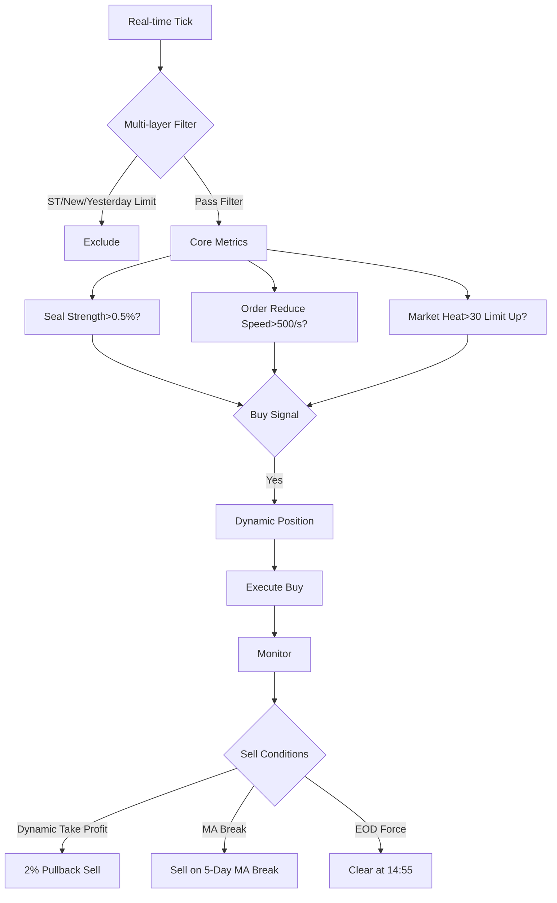

# curs

Curs is a personal automated quantitative investment platform.

[中文版](README.md) | English Version

## Current runtime: signals only

In the [Hot Stock Research Desk](http://localhost:5000/finance-board), select a stock and date to view its reports and sources. Analyze one stock or the full list on demand. At 21:30 Beijing time each day, Curs uses WorkBuddy Desktop Bridge to analyze up to 100 stocks from the latest hot-stock ranking and retries unfinished reports. See the [Research Desk guide](docs/STOCK_INTELLIGENCE.md).

Continuation assessment v1 adds shadow-only 1-to-2, 2-to-3 and higher-board observations to the existing market sentiment page. Environment, sampled sealing and explicit theme evidence are stored without modifying original strategies or placing orders. Empty theme groups do not pass. See the [design and roadmap](docs/RELAY_V1.md).

Signal views, charts and forward observations group opportunities by Shanghai trading date, security and direction. Expanded details retain each strategy's original trigger and independent price observations. Aggregate observations use the earliest trigger without summing quantities. The raw API remains unchanged; grouped lists use `view=opportunities`.

Observation pages use a high-contrast light style, 16px body text and horizontally scrollable tables. Candidate statuses and evidence have readable Chinese labels; timestamps omit fractional seconds while retaining seconds.

A 2026-10-14 review fixed timezone display, the discarded first tick, confirmation-state overwrites, journal locking during database mirroring, transactional hot-pool import, and the legacy profit page's QMT dependency. See the [review record](docs/REVIEW_20261014.md) for scope, tests and remaining limitations.

Stock APIs enrich display names and labels. Signal, candidate and position views show codes with names. Legacy names resolve from local metadata, the market universe and quote cache without external quote requests during page reads. New signals persist their names locally.

The weekday 16:00 collector stores complete closing limit-up snapshots in the existing PostgreSQL `zt_stocks` table, using a new nullable `snapshot JSONB` column. Next-session sentiment analysis reads the database first. Legacy code-only records can display price performance; missing board heights are not invented.

Code compatibility also includes the `302` ChiNext prefix; parsing of the complete live universe has been verified.

The market universe supports STAR securities with the `689` prefix (such as Ninebot-WD). Unsupported-code errors include the security code and venue for diagnosis.

The new [A-share sentiment dashboard](http://localhost:5000/market-sentiment) independently collects the Shanghai/Shenzhen/Beijing universe and quotes, showing coverage by board, breadth, frozen prior-session limit-up cohorts, and intraday promotion ladders. Insufficient coverage prevents sentiment classification. Rule-based observations do not predict tomorrow's money flows. Configure `market_sentiment`; see the [design document](docs/SIGNAL_ONLY.md).

The independent `first_board_confirmation` snapshot monitor runs alongside legacy strategies. The observation page shows candidates, confirmation, and rejection reasons. Signals require continuous limit-up snapshots, increased turnover amount, and stronger peers; they do not imply fills or profitability. Configure `market_data.first_board`.

The new [forward signal observation page](http://localhost:5000/signal-review) displays quote freshness and coverage, minute-level hot-pool environment snapshots, and post-signal price observations. Strategy tick events pause below the default 80% fresh coverage threshold. Observations do not confirm fills or represent actual trading returns. See the [design document](docs/SIGNAL_ONLY.md).

This project uses Tencent public five-level quote snapshots (polling every 5 seconds by default), retaining the original limit-up strategies. It does not launch QMT, place orders, or launch the separate Trading Agent. Snapshots are not tick-by-tick data and may miss brief order-book changes; signals are only recorded when strategy conditions match.

Use `signal_only: true` and `broker: signal`. Signals are persisted first in `data/strategy_records/signals.sqlite3`, then mirrored to PostgreSQL with status `SIGNAL_ONLY`, visible at `/signals`. Database outages retain local records for retry.

On Windows, `scripts/start_curs.ps1` starts this project on port 5000; `scripts/setup_schedule.ps1` updates existing startup tasks. After-market collection uses public limit-up lists. See [signal-only design](docs/SIGNAL_ONLY.md) for configuration, tasks, and limitations. The live-account, QMT, and trading descriptions below document legacy capabilities, not the current default runtime.

## Features

- **Public Quotes** - Tencent five-level snapshots, polled every 5 seconds by default
- **Multiple Brokers** - Use either QMT or Eastmoney Securities for the trading account
- **Strategy Trading** - Multi-strategy support with hot reloading
- **Signal Management** - Persist and deduplicate strategy signals without executing trades
- **Position Management** - Real-time position monitoring, one-click liquidation
- **Stock Pool** - Custom stock pools with categorization
- **Scheduled Tasks** - Configurable periodic tasks for data sync, profit analysis, etc.
- **Web Interface** - Graphical monitoring and management

## Strategy Logic



## Requirements

- Python 3.10+ (recommended)
- PostgreSQL 12+
- Access to public market-data endpoints; no QMT or live account required in the current mode

## Installation

```bash
# Clone project
git clone <repository-url>
cd curs

# Create virtual environment (optional)
python -m venv venv
venv\Scripts\activate  # Windows
# source venv/bin/activate  # Linux/Mac

# Install dependencies
pip install -r requirements.txt

# Install project
python setup.py install
```

## Configuration

`config.yml` (sensitive config should use `config.local.yml`):

```yaml
version: 0.1.0

# Database config
database:
  host: 192.168.2.238
  port: 6432
  database: postgres
  user: postgres
  password: ""  # Use config.local.yml

# Broker: qmt or eastmoney
broker: qmt

# QMT config (used when broker: qmt)
qmt:
  path: ""
  account_id: ""  # Use config.local.yml
  trader_name: ""

# Eastmoney config (used when broker: eastmoney)
eastmoney:
  account_no: ""
  password: ""  # Keep this in config.local.yml or an environment variable
  session_file: data/eastmoney_trader.session

# Strategy config
strategy:
  path: ./strategies
```

### Local Config

Put sensitive data in `config.local.yml` (gitignored):

```yaml
database:
  password: your_password

qmt:
  path: E:\qmt\userdata_mini
  account_id: "YOUR_ACCOUNT_ID"
  trader_name: curs
```

For Eastmoney, use this local override instead:

```yaml
broker: eastmoney

eastmoney:
  account_no: "YOUR_FUND_ACCOUNT"
  password: "YOUR_TRADING_PASSWORD"
  session_file: data/eastmoney_trader.session
```

Or use environment variables:

```bash
set CURS_DB_PASSWORD=your_password
set CURS_QMT_ACCOUNT_ID=YOUR_ACCOUNT_ID
```

Eastmoney can also be configured entirely through environment variables:

```bat
set CURS_BROKER=eastmoney
set CURS_EASTMONEY_ACCOUNT_NO=YOUR_FUND_ACCOUNT
set CURS_EASTMONEY_PASSWORD=YOUR_TRADING_PASSWORD
set CURS_EASTMONEY_SESSION_FILE=data/eastmoney_trader.session
```

## Eastmoney Securities Setup

The Eastmoney integration logs in to the web trading gateway with a fund account and trading password and does not route orders through QMT. On first login it recognizes the image captcha automatically and stores a reusable login session in `session_file`. It logs in again when that session expires. The current quote engine is still based on `xtquant`, so the MiniQMT quote service must be running for real-time strategies.

1. Verify that the account can sign in to Eastmoney web trading and that trading permissions are enabled.
2. Run `pip install -r requirements.txt` to install `pycryptodome`, `ddddocr`, and `pillow`.
3. Set `broker: eastmoney`, the fund account, and trading password in the gitignored `config.local.yml`.
4. Start the MiniQMT quote service; Eastmoney replaces only the trading account, not the current quote source.
5. For the first run, use `python run.py --engine-only -v` and look for an “Eastmoney account login succeeded” log entry.
6. Start the full service, open Position Management, and verify cash and positions. Disable live trading in Strategy Management while validating signals, then enable it only after verification.

Strategies should use the common factory instead of constructing a broker directly:

```python
from curs.broker import create_account

context.account = create_account(config, total_cash=100000)
```

The adapter currently supports cash and position queries, limit/market-parameter orders, cancellation, today's orders and trades, and liquidation. A-share T+1 rules still apply; liquidation only sells the available quantity reported by the broker. The quote engine still uses the QMT/xtquant data path, so selecting Eastmoney changes the trading account, not the market-data source.

> Risk notice: this integration depends on Eastmoney's web trading interface and may stop working if its API or login checks change. Both `config.local.yml` and `*.session` contain sensitive data and must not be committed, shared, or placed in a synced folder. Validate in signal mode and with small amounts first.

## Project Structure

```
curs/
├── curs/
│   ├── api/              # API endpoints
│   ├── broker/           # Trading interfaces (QMT / Eastmoney)
│   ├── collection/       # Data collection
│   ├── core/             # Core engine
│   ├── data_source/      # Historical data
│   ├── database.py       # Database manager
│   ├── log_handler/      # Logging
│   ├── strategy/         # Strategy loader
│   └── utils/            # Utilities
│       └── task_scheduler.py  # Task scheduler
├── web/
│   ├── app.py            # Web service
│   └── templates/        # Frontend pages
├── strategies/           # Strategy files
├── data/                 # Data files
│   └── create_scheduled_tasks.sql
├── test/                 # Test files
└── config.yml            # Configuration
```

## Database Setup

Create tables before first run:

```bash
psql -h 192.168.2.238 -U postgres -d postgres -f data/create_scheduled_tasks.sql
```

Or via Web UI (auto-created on first access).

## Running

```bash
# Use unified launcher (recommended)
python run.py                    # Start all services (Web + Engine)
python run.py --help             # Show help

# Run separately
python run.py --web-only         # Web service only
python run.py --engine-only      # Trading engine only

# Specify port
python run.py -p 8080            # Web port 8080
```

Visit http://localhost:5000

### Batch Scripts

Windows batch scripts are available in `E:\script\`:

| Script | Description |
|--------|-------------|
| `start_all.bat` | Start Curs hidden (public quotes and signals) |
| `startqmt.bat` | Disabled; does not launch QMT |
| `startcurs.bat` | Start Curs only |
| `start_web.bat` | Start Web service only |
| `restart_premarket.bat` | Restart only the original Curs project |
| `after_daily.bat` | After-market stock picking |
| `setup_schedule.bat` | Configure Windows scheduled tasks |

### Windows Scheduled Tasks

Configure via `setup_schedule.bat`:

| Task | Trigger | Description |
|------|---------|-------------|
| `CursBoot` | 90 seconds after boot | SYSTEM unattended startup, signal-only |
| `CursPreMarket` | Weekdays 08:50 | Restart Curs only |
| `CursAfterMarket` | Weekdays 16:00 | After-market stock picking |
| `CursDailyImport` | Daily 21:00 | Import collected data |

## Architecture

Curs uses a **single-process architecture**, with Web service and trading engine running in the same process:

```
run.py (single process)
├── Web Service (Flask, port 5000)
└── Trading Engine (Engine)
    ├── Strategy Manager (StrategyManager)
    ├── Trading Account (QmtStockAccount / EastMoneyAccount)
    └── Quote Engine
```

- **Strategy Mode Toggle**: Web UI can toggle strategies between live/signal mode
  - Live mode: receive quotes + execute orders
  - Signal mode: receive quotes + generate signals to DB, skip real orders
- **Broker startup**: QMT mode checks and starts QMT; Eastmoney mode logs in while strategies initialize
- **curs_main.py**: Backward-compatible shell, redirects to `run.py`

## Web Interface

| Module | Description |
|--------|-------------|
| Strategies | View and manage trading strategies |
| Signals | Query trading signals with filters |
| Stock Pool | Manage stock pools, batch add/remove |
| Positions | View positions, one-click liquidation |
| Scheduled Tasks | Configure and manage periodic tasks |

## Scheduled Tasks

Features:

- **Cron Expression** - Flexible timing, e.g., `0 15 * * *` = daily at 15:00
- **Fixed Interval** - Execute by seconds/minutes/hours
- **Dynamic Task Execution** - Run arbitrary Python script functions (configure script path + function name via Web UI)
- **Task Types**:
  - Sync hot stocks
  - Sync stock info
  - Profit analysis
  - Clear hot stocks
- **Execution Logs** - Record and view history

### Adding Tasks

Via Web UI `Scheduled Tasks` page:
1. Enter task name
2. Select task type
3. Configure Cron or interval
4. Click Create

### Cron Examples

| Expression | Description |
|------------|-------------|
| `* * * * *` | Every minute |
| `0 * * * *` | Every hour |
| `0 15 * * *` | Daily at 15:00 |
| `0 9 * * 1-5` | Weekdays at 9:00 |
| `0 0 * * *` | Daily at midnight |

## Modules

| Module | Description |
|--------|-------------|
| collection | Data collection (hot stocks,龙虎榜, etc.) |
| data_source | Historical data storage |
| broker | QMT / Eastmoney trading interfaces |
| strategy | Strategy loading and execution |
| core | Core engine (event dispatch, data feed) |
| utils | Utility functions |

## Dependencies

Core:
- pandas, numpy - Data processing
- pytdx - Market data
- Flask - Web framework
- psycopg2-binary - PostgreSQL
- schedule, croniter - Scheduling

Full list in `requirements.txt`

## Documentation

- [中文文档](README.md)
- [English Documentation](README_EN.md)
- [Hot stock intelligence design and usage](docs/STOCK_INTELLIGENCE.md)

## KOL directional intent and offline event research

Relay shadow context now supports `python -m curs.kol_intent.relay_context posts.csv`. Import public posts with author, original HTTPS URL, explicit stock code and timezone-aware publication time. The system records actual first-seen import time. Candidates only reference information published and imported before their timestamp. Evidence and disagreement appear on the existing sentiment page without overriding risk gates or emitting trades. See [integration rules](docs/KOL_RELAY.md). No fabricated opinions are supplied when inputs are missing.

The package lives in `curs/kol_intent/`, without live trading or core-engine changes. Configure `kol_intent` in `config.yml`, with existing `config.local.yml` overrides. Relative paths resolve against the selected configuration file directory.

```bash
python -m curs.kol_intent --config config.yml
python -m unittest test.test_kol_intent -v
```

Provide UTF-8 posts CSV: `timestamp,ticker,text`, and prices CSV: `timestamp,ticker,open,close` (`date/last` aliases accepted). Daily ticker rows must be unique and prices positive. Tickers load as strings to retain leading zeros. ISO and YYYYMMDD timestamps normalize to Shanghai time. Python callers can `from curs.kol_intent import analyze` and call `analyze(posts, prices, config)`. Use consistently adjusted prices and a point-in-time universe. Leave `prices_path` empty to call the existing public daily-bar interface with `tickers/price_count/adjustment`.

- Prefer local FinBERT; `local_files_only: false` permits downloads and `use_finbert: false` forces rules. Import, weights or inference failures log warnings and continue. Intent requires explicit directional words and a ticker present in prices. Negations/conflicts conservatively become neutral; ticker-less mentions are not inferred. The model supplies sentiment probabilities and pooled embeddings; rule evidence constrains intent. Chinese quality is not guaranteed, and confidence is not calibrated intent accuracy.
- Rule embeddings are deterministic 64-dimensional token hashes; model dimensions depend on the model. Events record backend; do not directly compare mixed embedding spaces.
- Enter at the first session open strictly after the long event date. Entry counts as day one; exit at day six open, or earlier at the open after a short event. No shorts or duplicate ticker holdings. Conflicts on the same execution day cancel entry. Sessions use the union of price dates; supply the actual research calendar.
- Rebalance equally at open; overnight gaps belong to previous holdings. Missing entry opens skip signals; missing exit opens defer liquidation. Missing valuations carry the last close; untradable holdings retain their weight. Unclosed trades remain `open_at_end` and contribute to NAV. Trade returns measure individual entry/exit prices; daily_returns measures the rebalanced portfolio.
- CAR sums stock close returns minus the available equal-weight market return over [-1,+5], without direction signing. Non-session events map to the next session. Incomplete CAR is null. Mean-curve sample counts are reported per day; missing windows can change sample composition.
- Compare intent with sentiment-only signals: cumulative return, annualized Sharpe (252 sessions, zero risk-free rate), maximum drawdown, UER and DRR. UER = entries without explicit long rule support / entries. DRR = adjacent non-neutral reversals within ticker / comparable pairs. Numerators and denominators are retained; empty denominators and zero-volatility Sharpe are null. Intent UER is zero by construction, not human-labeled accuracy.

Exports include event/trade/daily-return/CAR/mean-curve and sentiment baseline CSVs, `mean_car.png`, `report.json` and `report.md`. Simulated fills assume available opens, zero fees/slippage and no price-limit or liquidity checks. Dependencies are declared in `requirements.txt`; rule mode also runs without model packages.

## Development Direction

- Live Trading - Optimize trading execution and risk management
- Strategy Optimization - Improve strategy profitability
- Data Collection - Scheduled tasks automation (hot stocks, profit analysis, etc.)
  - Multi-platform rankings (Eastmoney, Tonghuashun, Xueqiu, etc.)
  - News scraping and analysis
  - Dragon List (龙虎榜), capital flow, sector rotation

## TODO

- [x] PostgreSQL storage
- [x] Scheduled tasks management
- [x] Single-process architecture (Web + Engine)
- [x] Strategy live/signal mode toggle
- [x] QMT auto-start
- [ ] Enhanced data collection (multi-platform, news analysis)
- [ ] Live trading optimization
- [ ] Strategy performance analysis

## Documentation

- [中文文档](README.md)
- [English Documentation](README_EN.md)
